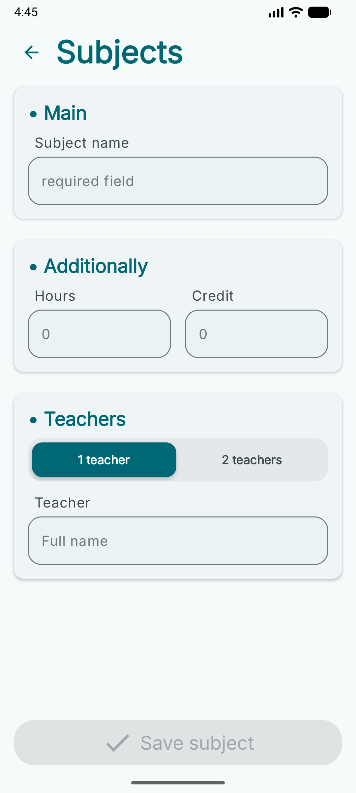
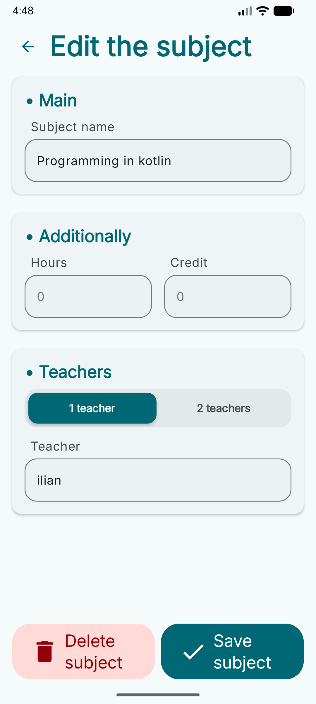

# StudyMate

StudyMate is an Android application for students to manage their academic schedule, course subjects,
current grades, and attendance limits. All subject data is stored locally on the device using Room.

> **Project Status:** Work in Progress (WIP). The subject workflow (list, details, add, edit, delete)
> is fully functional and persisted in Room. The Schedule screen still runs on mock data.

---

## Tech Stack

* **Language:** Kotlin
* **UI:** Jetpack Compose, Material 3 (light and dark themes)
* **Navigation:** Navigation Compose (`NavHost` / `NavController`)
* **Local storage:** Room (with custom `TypeConverters` for grade lists)
* **Async and state:** Kotlin Coroutines, `Flow`, `StateFlow`
* **Architecture:** MVVM + Repository pattern, manual dependency injection

---

## Features

### Schedule Screen
* Displays days of the week and the current week type (upper/lower).
* Shows the class schedule for the selected day and week type.
* *Note:* Partially complete. It currently uses mock data and will be finalized after Room persistence is added for lessons.

### Subject Screen
* Displays a list of all enrolled subjects, loaded from Room as a `Flow`.
* Floating Action Button (FAB) opens the Subject Add screen; the FAB hides while the list is scrolling.
* Each subject card opens the detail screen on tap and the edit screen via its edit action.
* Bottom navigation bar for switching between Schedule and Subjects.

### Subject Detail Screen
* **Overall score** out of 50, calculated from all grade categories and attendance.
* **Grade categories**, each with its own card:
    * Seminar grades (shows average)
    * Colloquium grades (shows average)
    * Independent work grades (shows the running sum, capped at 10 points; the add button disappears once the cap is reached)
* **Grade management** via a bottom sheet: add, edit, and delete individual grades, with input validation (grades up to 10).
* **Attendance tracking:** a counter for missed lessons with `+` / `−` buttons and an automatically calculated absence limit based on the subject's total hours.
* Expandable subject info card (teachers, hours, credits).
* Overflow menu with **Edit** and **Delete** actions.

### Subject Add Screen
* Form for creating a new subject:
    * Subject name (required)
    * Total hours (optional, up to 150)
    * Credit score (optional, up to 15)
    * Teachers: either one teacher for both lectures and seminars, or separate lecture and seminar teachers
* Live input validation; the **Save** button stays disabled until the form is valid.

| Field        | Rule                                                                  |
|--------------|-----------------------------------------------------------------------|
| Subject name | Required, up to 50 characters, must not start with a space or a digit |
| Teacher name | Optional, up to 20 characters, must not start with a space or a digit |
| Hours        | Digits only, max 150                                                  |
| Credit score | Digits only, max 15                                                   |

### Subject Edit Screen
* Reuses the same form UI and validation logic as the Add screen (shared `SubjectFormViewModel`).
* Loads the existing subject from Room and pre-fills the form.
* Saving updates only the editable fields; existing grades and missed lessons are preserved.
* Includes a **Delete subject** button.

### Screenshots

| Subject Add Screen                                                              |                                                            Subject Edit Screen |
|:--------------------------------------------------------------------------------|-------------------------------------------------------------------------------:|
|  |  |

---

## Architecture

The app follows a simple layered structure:

```
UI (Compose screens)  ->  ViewModel (StateFlow)  ->  Repository  ->  Room DAO  ->  SQLite
```

* **`Subject`** is a Room `@Entity`. Grade lists (`seminarGradesList`, `colloquiumGradesList`, `independentWorkGradesList`) are stored as `List<Int>` through `Converters`.
* **`SubjectDao`** exposes `Flow`-based queries plus suspend functions for insert, update, and delete.
* **`SubjectRepository`** is an interface; **`OfflineSubjectRepository`** is its Room-backed implementation.
* **`AppContainer` / `AppDataContainer`** provide dependencies manually, and **`AppViewModelProvider.Factory`** creates the ViewModels.
* **Screens are split into a stateful wrapper and a stateless `...Content` composable.** This keeps the UI previewable (light and dark) with `TestData`.
* **`SubjectFormViewModel`** is an abstract base class holding the shared form state and validation. `SubjectAddScreenViewModel` and `SubjectEditScreenViewModel` extend it.
* **`SubjectDetailScreenViewModel`** combines the subject `Flow` from Room with local UI state (`combine` + `stateIn`) so calculated values such as averages, attendance score, and absence limit are always in sync with the database.

### Package overview

```
com.studymate
├── data        # Entities, DAO, database, repository, AppContainer
├── ui
│   ├── navigation          # NavigationDestination and NavHost
│   ├── theme               # Material 3 theme
│   └── screens
│       ├── subjectScreen        # Subject list
│       ├── subjectDetailScreen  # Grades, attendance, overall score
│       ├── subjectAddScreen     # Add form and shared form ViewModel
│       ├── subjectEditScreen    # Edit form
│       └── components           # Reusable composables
└── util        # Converters and grade / attendance calculation helpers
```

---

## Roadmap

- [x] Subject Screen, Subject Detail Screen
- [x] Subject Add screen
- [x] Subject Edit screen (edit and delete)
- [x] Local database storage for subjects (Room)
- [ ] Finalize Schedule Screen with Room persistence
- [ ] Replace destructive database migration with proper Room migrations
- [ ] Add class reminders and notifications

---

## Getting Started

1. Clone the repository:
   ```bash
   git clone https://github.com/IlgarM4224/Study-Mate.git
   ```
2. Open the project in Android Studio.
3. Sync Gradle dependencies.
4. Run the app on an emulator or physical Android device.